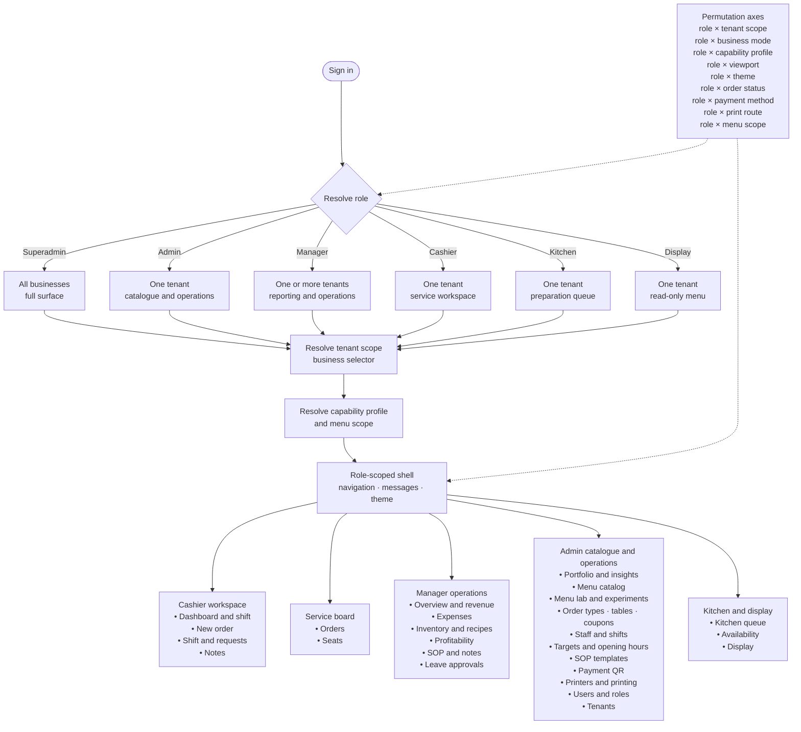

# Light POS feature flow

Role, tenant scope, capability, and feature-surface flow for the implemented product.

[Styled HTML version](light-pos-feature-flowchart.html)

The flow resolves identity first, then tenant scope, then the capability profile and menu scope. The role-scoped shell exposes only the feature surfaces allowed by that profile. The `Permutation axes` node captures the cross-cutting combinations that change what a user sees or can do.
